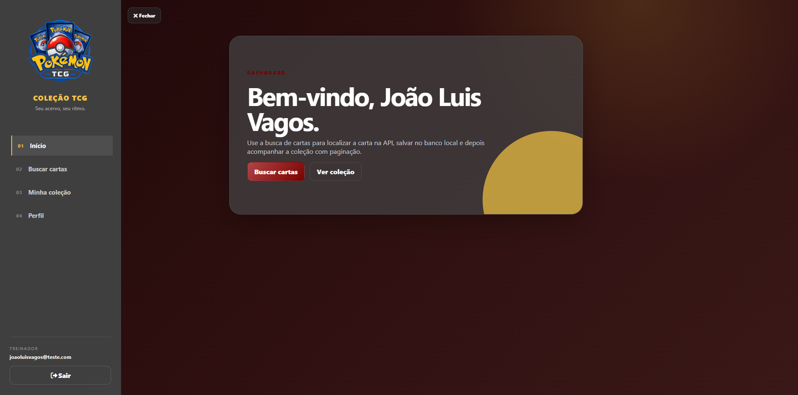
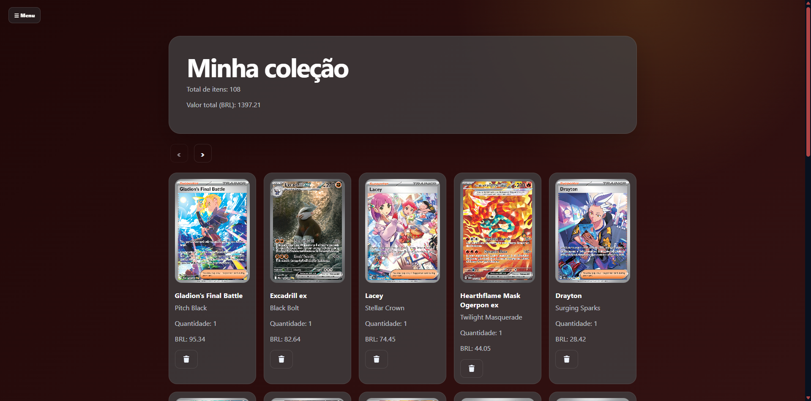

# Collection Pokémon TCG

Sistema web para gerenciamento de coleção de cartas do Pokémon Trading Card Game (TCG), permitindo que usuários organizem sua coleção, acompanhem valores das cartas e gerenciem seu inventário de forma prática.

## ✨ Funcionalidades

- 👤 Cadastro e login de usuários
- 🔐 Autenticação com JWT
- 🃏 Visualização de cartas
- 📚 Gerenciamento da coleção pessoal
- 💰 Exibição de preços em BRL e USD
- 📈 Controle de quantidade de cartas
- 🔎 Busca e filtros
- 🏆 Ordenação da coleção por raridade
- 🖼️ Fallback e normalização das imagens das cartas

---

## 🖼️ Demonstração

### Tela inicial



### Coleção de cartas



### Pesquisa e adição de cartas


---

## 🛠 Tecnologias

### Front-end

- React 19
- React Router DOM
- Axios
- Font Awesome
- CSS

### Back-end

- Node.js
- Express
- MySQL
- JWT
- bcryptjs
- dotenv

---

## 📂 Estrutura do projeto

```
Collection-Pokemon-TCG
│
├── front-end/
│   ├── public/
│   ├── src/
│   └── package.json
│
├── back-end/
│   ├── src/
│   │   ├── config/
│   │   ├── database/
│   │   └── modules/
│   └── package.json
│
└── README.md
```

---

## ⚙️ Instalação

### Aplicação publicada

- Front-end: https://collection-pokemon-tcg-kappa.vercel.app/
- API: https://collection-pokemon-tcg.onrender.com
- Health check: https://collection-pokemon-tcg.onrender.com/health

O workflow `Keep API alive` executa uma chamada ao health check a cada 10 minutos para reduzir o tempo de inicialização da API no Render. O agendamento do GitHub Actions pode sofrer atrasos e não substitui um plano de hospedagem sem suspensão automática.

### Clone o projeto

```bash
git clone https://github.com/JoaoLuisVagos/Collection-Pokemon-TCG.git
```

### Backend

```bash
cd back-end
npm install
```

Crie um arquivo `.env`:

```env
PORT=3001
LANGUAGE_DISCOUNT_PERCENT=18
JWT_SECRET=seu-segredo-jwt
JWT_EXPIRES_IN=7d

MYSQL_HOST=
MYSQL_PORT=3306
MYSQL_USER=
MYSQL_PASSWORD=
MYSQL_DATABASE=
MYSQL_SSL=false
LIGA_POKEMON_URL_TEMPLATE=https://www.ligapokemon.com.br/?view=cards/card&card={card_name}
```

Para conectar ao MySQL hospedado com SSL, preencha `MYSQL_HOST`, `MYSQL_PORT`, `MYSQL_USER`, `MYSQL_PASSWORD` e `MYSQL_DATABASE`, e use `MYSQL_SSL=true`. Nunca versionar o arquivo `.env` nem publicar credenciais.

`LIGA_POKEMON_URL_TEMPLATE` é obrigatória para consultar preços na Liga Pokémon e deve conter o marcador literal `{card_name}`, que será substituído pelo nome codificado da carta. Para o formato atual da Liga, use `https://www.ligapokemon.com.br/?view=cards/card&card={card_name}`. Quando `edition` for informado na rota, o back-end acrescentará `&ed=<codigo>`.

Execute:

```bash
npm run dev
```

---

### Front-end

```bash
cd front-end
npm install
npm start
```

---

## 🗄 Banco de dados

O projeto utiliza MySQL.

As migrations estão em:

```
back-end/src/database/migrations
```

Execute os arquivos SQL na ordem numérica (`001` a `008`) no banco configurado. A migration `004-create-card-prices.sql` cria a tabela de cache `card_prices`; a `005-add-edition-code-to-cards.sql` adiciona o código opcional da edição da Liga; a `006-add-image-url-to-card-prices.sql` adiciona a URL da imagem da Liga ao cache; a `007-add-liga-reference-to-cards.sql` salva nome, número, total impresso e referência completa da Liga; e a `008-link-card-prices-to-cards.sql` cria a FK entre `card_prices` e `cards`, além de vincular os preços já existentes.

### Preços da Liga Pokémon

A rota `GET /prices?name=<nome>&edition=<codigo-opcional>` consulta o cache de preços por até 24 horas e só então acessa a Liga Pokémon. Se a Liga estiver indisponível, um cache antigo é devolvido com `stale: true`.

Ao buscar uma carta pela tela de cartas, a prévia consulta a Liga Pokémon e exibe o preço médio (`m`) em BRL. TCGdex continua sendo usado para dados e imagens. Se a Liga estiver indisponível, o preço de mercado existente é usado como fallback e a mensagem da prévia informa a origem.

Exemplo local:

```bash
curl "http://localhost:3001/prices?name=Charizard&edition=ABC"
```

No front-end, essa rota pode ser chamada a partir da tela que exibe os detalhes ou preços de uma carta, depois que o nome da carta e, opcionalmente, o código da edição estiverem disponíveis.

### Atualização de cartas

Para atualizar preços, raridades e imagens das cartas já cadastradas:

```bash
cd back-end
node src/scripts/attPricesCards.js
```

O script obtém automaticamente do catálogo público de cartas o nome, número, total impresso da coleção e código equivalente da edição. Com esses dados, monta a referência da Liga (por exemplo, `Gladion's Final Battle (118/084)`), consulta o HTML da Liga e usa o preço médio (`m`) nas colunas de preço já exibidas pela aplicação. Cartas sem metadados suficientes são preservadas e aparecem no relatório do script.

---

## 🚀 Scripts

### Front-end

```bash
npm start
npm test
```

### Back-end

```bash
npm run dev
npm start
```

---

## 📌 Funcionalidades futuras

- Favoritar cartas
- Dashboard de estatísticas
- Histórico de preços
- Importação de coleção
- Exportação para CSV
- Dark Mode
- Phone Visual

---

## 👨‍💻 Autor

João Luis Vagos

GitHub:
https://github.com/JoaoLuisVagos

---

## 📄 Licença

Projeto desenvolvido para fins de estudo.
